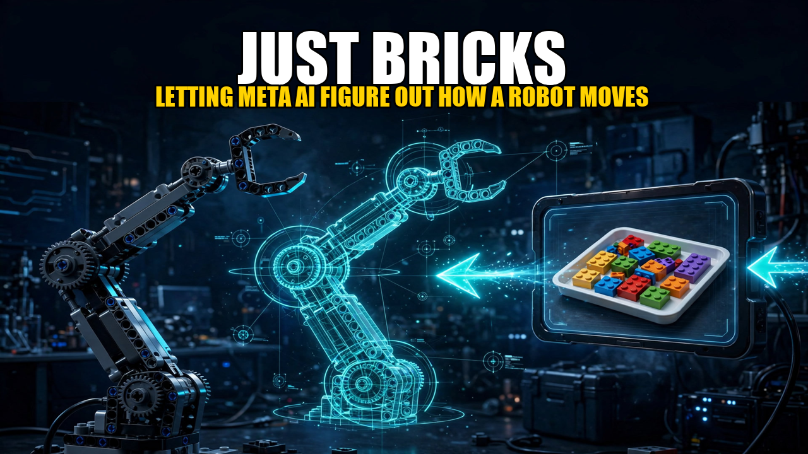

# Just Bricks

**Letting Meta AI figure out how a robot moves: infer the kinematics, drive two EV3
bricks, and teach a vision-language policy to point at blocks.**



**Demo video:** [Just Bricks on YouTube](https://youtu.be/9nLjkKq9cKk)

Given only a brick-level LEGO assembly (part IDs and poses — no joints, no
rig, no kinematics), this project geometrically infers the robot's kinematic
chain, generates FK/IK and an executable EV3 control program, drives the
physical robot through a web console, and trains a VLA pointing policy on
auto-generated demonstrations — then proves it on real camera photos.

```
Studio .io ──▶ kinematic inference ──▶ FK/IK + EV3 program ──▶ real robot
                                                        │
MuJoCo demos ──▶ SmolVLA fine-tune ──▶ webcam test ──▶ hold pose ──▶ robot
```

## Highlights

| Result | Number |
|---|---|
| IK accuracy vs ground truth (sim, n=500) | median 0.45 mm |
| VLA, sim scenes (100 unseen) | 43% → **46%** after fine-tune |
| VLA, real photos, same setup (15) | 0/15 → **15/15 @ 4.1 mm mean error** |
| VLA, real photos, new lighting (14) | 3/14 → 3/14 (next task: varied environments) |
| Test suite | 455 pytest cases + browser smoke + static gates, green |

The honest headline: a small real dataset fits its own shooting setup
(0 → 15/15) but does not survive a lighting change (3/14, same as before).
That measurement — local and Modal evaluations agreeing — is the result.

## How it works

1. **Infer.** An agent plus deterministic geometry tools segments links,
   finds joint axes, traces gear trains and coupling from the Studio file
   (`src/parse/`, `src/catalog/`, `src/kin/` → `models/robot_inferred.*`).
2. **Drive.** A single-file web console (`src/console/control.py`,
   3D + IK + calibration wizards + send gates) commands two EV3 bricks
   over MQTT/Bluetooth. On-brick MicroPython guards (sensors, stall,
   heartbeat, latch) enforce safety below the UI, which can never
   bypass them.
3. **Point.** MuJoCo renders 400 pointing demos → SmolVLA fine-tune on
   Modal → a shared 50-action `drain_chunk()` keeps only the hold pose
   (first-frame protocol). A webcam panel (capture → infer → overlay →
   low-speed send → human vote) closes the loop on real photos.
4. **Prove.** Same-setup, new-lighting, and random baselines are scored
   before/after; leakage is hash-checked; local and cloud evals must agree.

Two robots are supported (6-joint MR JOS for hardware, T-Bot virtual-only
for generalisation), and the whole console speaks Korean and English
(toggle in the top bar).

## Quickstart

```bash
source .venv/bin/activate
# Web console (fake bricks by default — safe, fully reproducible)
python -m src.console.control --port 8766
# → open http://127.0.0.1:8766/ in a browser
```

Real hardware: copy `src/ev3/brick_mp/` to both bricks (left gets
`left_main.py` + `brick_left.json`, right gets `right_main.py` +
`brick_right.json`), start the broker (`scripts/start_broker.sh`), and run
the console with `--config config/hardware.local.yaml`. Boot prints
`brick sw version: 5B.18` on each brick.

```bash
# Gate (must stay green)
.venv/bin/python -m pytest tests/test_control.py tests/test_vla.py \
  tests/test_stage9b.py tests/test_brick_mp.py tests/test_brick_hw.py -q
# Browser smoke (fake camera → infer → preview → fake-brick send)
.venv/bin/python scripts/ui_smoke.py --port 8767 --phase vla --out runs/ui_smoke
```

## Layout

| Path | What lives there |
|---|---|
| `src/console/control.py` | Web console: server, API, page, JS, 3D view, KO/EN toggle |
| `src/ev3/brick_mp/` (+ `brick/` copy) | On-brick MicroPython programs, version-stamped |
| `src/kin/` | FK / numeric IK, MuJoCo model loading |
| `src/vla/` | Sim scenes, demos, shared drain, inference, twin, Modal jobs |
| `config/` | Camera/table config (secrets and calibration stay in git-ignored `*.local.yaml`) |
| `runs/` | Photos, checkpoints, eval records — git-ignored, never delete blindly |
| `docs/` | [`DESIGN.md`](docs/DESIGN.md) (design, Korean) · [`PLAN.md`](docs/PLAN.md) · stage logs (`docs/stage/`) |
| `tests/`, `scripts/` | 455 pytest cases · smoke, collection, eval, broker helpers |

## Safety and privacy

- Every real-robot move passes preview → range check → human confirm →
  low speed (15°/s). Fake brick and fake camera are the defaults.
- Real photos live only under `runs/` (git-ignored). Private LEGO geometry
  is never committed; a release guard test enforces this, and Modal uploads
  go through an allow-list check.

## Built with

MuJoCo · LeRobot / SmolVLA (SmolVLM2) · Pybricks / MicroPython · MQTT ·
three.js · Modal · Muse Spark (kinematic inference, SAM-assisted checks)

*LEGO® is a trademark of the LEGO Group, which does not sponsor or endorse
this project. Private building-instruction geometry is not distributed.*

