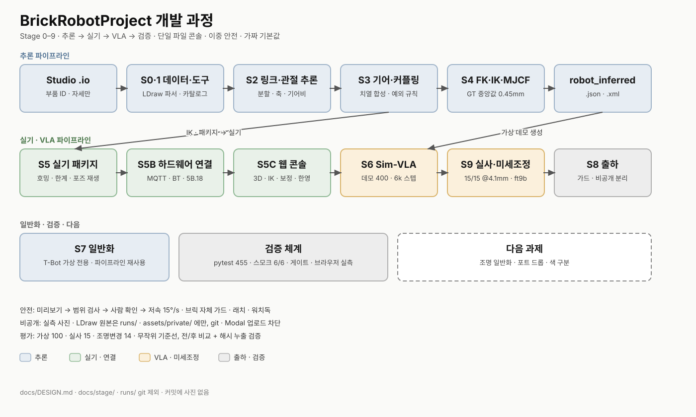

# BrickRobotProject 설계와 구조

이 문서는 과제 전체의 설계 의도와 시스템 구조를 한 곳에 정리한 것이다.
단계별 진행 기록은 [`docs/stage/English/`](stage/English/)와
[`docs/stage/Korean/`](stage/Korean/)에, 실행 계획은
[`docs/PLAN.md`](PLAN.md)에 있다.

## 1. 과제 개요

**입력:** 관절·정운동학 정의가 전혀 없는 브릭 단위 LEGO 조립 데이터
(부품 ID와 자세만 있는 Studio 파일).

**출력:** (1) 추론된 운동학 체인(링크·관절축·기어비·커플링)과 FK/IK,
(2) 그 IK로 실제 움직이는 EV3 제어 프로그램,
(3) 생성된 IK가 자동으로 만든 데모로 학습한 VLA 포인팅 정책.

핵심 주장은 하나다. **에이전트가 기하학적 사실만으로 로봇을 추론하고,
그 결과물이 시뮬레이션을 거쳐 실물 로봇의 손끝까지 이어진다.**
추론 → 검증 → 생성 → 실기 → 시각-언어 정책이라는 다섯 고리가 끊어지지
않게 잇는 것이 이 저장소의 설계 목표다.

## 2. 전체 파이프라인



| Stage | 내용 | 산출물 | 상태 |
|---|---|---|---|
| 0–1 | 데이터·도구 (LDraw 파서, 부품 카탈로그, 배선 검사) | `src/parse/`, `src/catalog/` | 완료 |
| 2 | 링크 분할·관절 추론 (변위 기반 분할, 축 추론) | `models/robot_inferred.json` | 완료 |
| 3 | 기어·커플링 (치열 합성, J2 보정, 손목 예외 규칙) | `runs/stage3/pred_C.json` | 완료 |
| 4 | FK/IK·MJCF (수치 IK, GT 오차 중앙값 0.45 mm) | `src/kin/`, `models/robot_inferred.xml` | 완료 |
| 5 | 실기 패키지·호밍·한계 측정·포즈 재생 | `generated/`, `src/homing/` | 완료 |
| 5B | 하드웨어 연결 (MQTT+Bluetooth, 양쪽 브릭) | `src/ev3/brick_mp/` (5B.18) | 완료 |
| 5C | 웹 콘솔 (3D·IK·보정 마법사·전송 게이트) | `src/console/control.py` | 완료 |
| 6 | Sim-VLA (가상 데모 400개 → SmolVLA 6,000 스텝) | `runs/vla/ckpt`, `src/vla/` | 완료 |
| 7 | 일반화 (두 번째 로봇 T-Bot, 가상 전용) | `generated_robots/` | 완료 |
| 8 | 출하 (릴리스 가드, 비공개 분리) | `tests/test_release.py` | 완료 |
| 9 | 실기 세션 (IK 실전송, VLA 웹캠 판정, 미세조정) | `runs/stage9/`, 본 문서 §8 | 완료 |

## 3. 시스템 아키텍처

```
 Studio .io ──▶ 추론(에이전트+기하 도구) ──▶ robot_inferred.json/xml
                                                      │
            ┌─────────────────────────────────────────┼──────────┐
            ▼                                         ▼          ▼
   ┌──────────────┐                        ┌──────────────┐  ┌─────────┐
   │ Web Console  │── MQTT(허브) ──▶ 좌 브릭 ──BT──▶ 우 브릭 │  │ MuJoCo  │  │ Modal   │
   │ (PC, 3D+IK)  │   전송·래치·심박  │ (5B.18, MicroPython) │  │ sim/IK  │  │ VLA학습 │
   └──────────────┘                        └──────────────┘  └─────────┘
            │                                                ▲          │
            └──────── VLA 웹캠 패널 ── 캡처→추론→유지자세 ────┘          ▼
                                   SmolVLA ckpt (6k → ft9b 3k)
```

다섯 컴포넌트와 경계는 다음과 같다.

- **Web Console** (`src/console/control.py`, 약 4,600줄 단일 파일).
  HTTP 서버·API·HTML/JS·3D 뷰어를 한 파일에 둔다. 배포물과 화면이
  항상 같은 버전이 되도록 하기 위한 의도적 선택이다. IK 풀이·전송
  게이트·보정 마법사(M4 방향, M5 범위, M6 재현)·디지털 트윈·VLA 웹캠·
  한영 토글까지 전부 이 파일에서 서비스한다.
- **EV3 Bricks** (`src/ev3/brick_mp/`, 양쪽 브릭 동일 복사본).
  MicroPython/Pybricks 위에서 포트 단위로만 동작한다(관절 이름 모름).
  센서 가드·스톨 가드·심박 워치독·래치를 자체 강제하고, PC와는 MQTT
  토픽(`robot/cmd·ack·state·event·estop·heartbeat`)으로만 대화한다.
  왼쪽이 마스터(PC↔MQTT, 우측↔Bluetooth 중계), 오른쪽이 슬레이브다.
- **Sim/Kinematics** (`src/kin/`, MuJoCo MJCF).
  원시(primitive) 지오메트리만으로 FK/수치 IK를 제공하고, VLA 데모
  생성과 전송 전 미리보기의 기준으로 쓰인다. GT 뼈대와 대조해
  IK 오차(중앙값 0.45 mm, n=500)를 보증한다.
- **VLA** (`src/vla/`).
  가상 카메라 이미지 + 지시문 + 50-스텝 행동 청크(LeRobot 형식) 파이프라인.
  핵심은 공용 `drain_chunk()`: 고정 첫 프레임 + 상태 되먹임으로
  50개 행동을 뽑아 **마지막(유지) 자세만** 쓰는 first-frame 프로토콜이다.
  모든 소비자(eval·추론·웹캠·디지털 트윈)가 같은 함수를 써서,
  "한 번 호출하고 끝" 류의 버그가 다시 못 들어오게 했다.
- **Modal 학습** (`src/vla/trial_modal.py`).
  무거운 학습·평가는 클라우드에서 `--detach`로 돌리고, 명령만 저장소에
  둔다. Volume 경로는 Volume 기준(`data/` prefix 없음)으로 통일했다.

## 4. 저장소 구조

```
src/console/control.py      # 웹 콘솔 (서버+페이지+JS, 한영 토글 포함)
src/console/calib_session.py# 보정 세션 연속성 (주차·복원·확정)
src/ev3/brick_mp/           # 브릭 프로그램 원본 (left/right_main, motors…)
src/ev3/brick_mp/brick/     # 브릭 배포용 복사본 (내용 동일, 버전 마커 강제)
src/ev3/fake.py             # 가짜 브릭 (실물 없이 전 기능 시험)
src/kin/                    # FK/수치 IK, 모델 로딩, GT 대조
src/vla/                    # scene/demo/drain/infer/eval/twin (Sim-VLA 전부)
src/vla/trial_modal.py      # Modal 작업 (학습·평가·데이터 생성)
src/homing/  src/limits/    # 호밍·한계 측정 로직
src/render/  src/viz/       # LDraw 렌더, 포즈 검증
config/                     # sim_camera.yaml 등 (비밀·교정은 *.local.yaml, git 제외)
runs/                       # 사진·체크포인트·평가 기록 (git 제외, 보존 대상 포함)
docs/stage/                 # 단계 문서 (English/ + Korean/)
tests/                      # pytest 455개 (아래 §7)
scripts/                    # 스모크(ui_smoke.py), 수집·평가, 브로커 기동
```

## 5. 핵심 설계 결정

1. **단일 파일 콘솔.** 서버·API·마크업·JS를 `control.py` 하나에 둔다.
   파일이 곧 배포 단위라 "화면 따로, 서버 따로" 버전 꼬임이 없다.
   대가(4,600줄)는 영역 주석과 `ui_smoke.py` 페이즈 검사로 감당한다.
2. **이중 안전.** 운동 제한·커플링·경로 검사는 PC 코어가, 모터각
   한계·센서·스톨·심박은 브릭이 각자 강제한다. UI는 어느 쪽도 우회할
   수 없고, 모든 거부는 이유 문자열과 함께 로그에 남는다.
3. **저속·확인 후 전송.** 실기 전송은 미리보기→범위 검사→사람 확인→
   저속(15°/s) 순서를 건너뛸 수 없다. VLA 유지자세도 같은 게이트를 탄다.
4. **가짜가 기본값.** 브릭·카메라 모두 fake가 기본이고 실물은 명시적
   선택이다. 덕분에 VLA 평가는 실물 없이도 100% 재현된다.
5. **first-frame + 공용 drain.** 50개 행동을 다 뽑고 마지막 유지자세만
   쓴다. `drain_chunk()` 하나로 통일해, 호출 1회 버그(§8의 교훈)가
   재발할 여지를 없앴다. 상태 되먹임 출처(sim/MuJoCo vs command)는
   결과에 기록된다.
6. **버전 마커.** 모든 브릭 파일 머리에 `# brick-sw-version`을 찍고
   테스트가 전수 일치·출력 일치를 강제한다. 오래된 복사본이 브릭에
   남아 있으면 첫 줄 로그에서 바로 드러난다 (현재 5B.18).
7. **비공개 분리.** 실측 사진·LDraw 원본·시각 팩은 `runs/`·`assets/private/`에만
   두고 git에 올리지 않는다. 릴리스 가드(`test_release.py`)가 유출을
   막고, 업로드 목록 검사(`_check_upload_list`)가 Modal 업로드를 막는다.
8. **한영 토글.** 표시 문자열 380개를 `STR` 사전 하나로 몰고 `T()`로만
   내보낸다. 서버 변경 없이 클라이언트에서 교체되며, 기본값은 한국어,
   선택은 브라우저에 저장된다. 논리에 쓰이는 한글(상태 접두어 판별 등)은
   한영 모두 검사하도록 했다.

## 6. 데이터 흐름 (VLA)

```
MuJoCo 가상카메라 ──▶ 데모 400개 (휴식5·접근30·유지15 스텝, ≤5°/스텝)
        + 실사 15배치(학습) ──▶ LeRobot 형식 ──▶ SmolVLA 6,000스텝 (A100)
                                                      │  Modal --detach
        실사 5배치(시험, 학습 제외)                    ▼
        실사 5배치(조명 변경, 학습 제외) ──▶ ft9b 3,000스텝 (T4)
                                                      │
평가: 가상 100장면 + 실사 15 + 조명변경 14 (+ 무작위 기준선)
      전/후 비교, 성공=끝점 30mm 이내·받침대 위 40~90mm
```

- 시험용 실사는 학습에 절대 넣지 않는다(해시로 누출 검증).
- 평가는 로컬 GPU와 Modal이 같은 조건에서 일치함을 확인했다
  (1샘플 차이는 flow-matching 샘플링 노이즈로 기록).

## 7. 검증 체계

| 층 | 수단 | 내용 |
|---|---|---|
| 단위 | pytest 455개 | kinematics·brick·console·VLA·릴리스 가드 |
| 계약 | `test_version_markers_match_and_printed` | 브릭 12파일 마커+버전 일치 |
| 정적 | pyflakes + MicroPython 제약 테스트 | 브릭 코드는 f-string·어노테이션 금지 등 |
| 스모크 | `scripts/ui_smoke.py` (vla 페이즈 6/6) | 가짜 카메라→추론→미리보기→가짜 브릭 전송 |
| 실연 | 브라우저 실측 | 토글·전송·VLA 패널의 DOM 단언 + 스크린샷 |
| i18n | 완전성 테스트 6개 | 한글 리터럴 전수 `T()` 커버, 서빙 스크립트 파싱·균형 |

## 8. 결과 요약

| 조건 | 미세조정 전 (6,000) | 후 (ft9b 3,000) |
|---|---|---|
| 가상 100장면 | 43% | 46% |
| 실사 동일 환경 15장 | 0/15 (Modal) · 1/15 (로컬) | **15/15 (오차 4.1 mm)** |
| 실사 조명 변경 14장 | 3/14 | 3/14 |
| 무작위 기준 | 가상 0% · 실사 33% | 동일 |

결론 문장: 로컬과 Modal 평가는 일치한다. 같은 촬영 환경에서는
0~1/15 → 15/15로 개선됐지만, 조명을 바꾸면 3/14로 미세조정 전과 같다.
적은 실사 데이터는 촬영 환경에 맞춰질 뿐이며, 다양한 환경의 데이터가
다음 과제다. (전체 행: `runs/stage9/eval_real_local_test.json`,
`runs/stage9/eval_real_local_holdout.json`. 체크포인트
`runs/vla/ckpt`, `runs/vla/ckpt-ft9b` 및 Volume의 두 학습물은
삭제하지 않는다.)

## 9. 한계와 다음 과제

- **조명·환경 일반화.** 위 표가 말해주듯, 다음 데이터는 여러 환경에서.
- **포트 드롭.** 실기 중 브릭 포트 끊김은 하드웨어 이슈로 미해결.
  `dmesg`+Read 상태 확보 후 재시도하는 것이 현재 절차다.
- **색상 구분.** 가상에서조차 지시 색상 적중률이 낮다(41% 중 오색 45%).
  데모 수·VLM 층수·도메인 랜덤화가 원인 후보이며, 재학습 판단은 보류다.
- **모바일 허브.** 브릭 프로토콜은 허브 종류와 무관하게 설계됐으나
  (주소만 바꾸면 됨), 모바일 포팅은 문서 계획 단계다.

## 10. 문서 인덱스

- 실행 계획: [`PLAN.md`](PLAN.md) · 에이전트 규칙: [`AGENTS.md`](AGENTS.md)
- 단계: [`stage/English/`](stage/English/) · [`stage/Korean/`](stage/Korean/)
- VLA 실사 최종: [`stage/English/stage-9-physical.md`](stage/English/stage-9-physical.md)
- VLA 학습 기록: [`stage/English/stage6_dev.md`](stage/English/stage6_dev.md)
- 콘솔·브릭 설계(원안): [`stage/English/stage-5c-control-console.md`](stage/English/stage-5c-control-console.md),
  [`stage/English/stage-5b-hw-connectivity.md`](stage/English/stage-5b-hw-connectivity.md)

