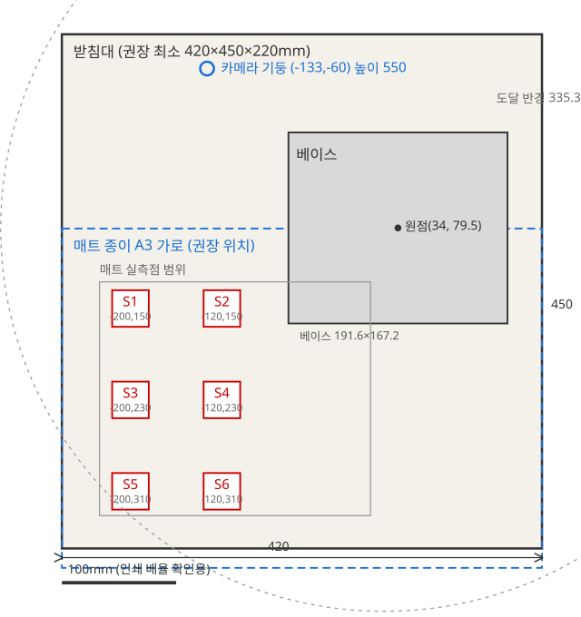

# 실물 세션 절차 (디지털 트윈 + 보정 유지)

실물 카메라는 쓰지 않는다. 실물 블록을 슬롯에 놓고 같은 배치를 가상
이미지로 렌더한 뒤 VLA(또는 정답 파이프라인 폴백)가 유지 자세를 내고,
콘솔 확인 후 저속으로 실물에 보낸다. 영상·README에는 "실물 카메라
영상은 쓰지 않았다"고 밝힌다.

## 1. 받침대

| 항목 | 값 | 출처 |
|---|---|---|
| 윗면 | 로봇 좌표 z=0 (모든 매트 점·IK·보고서 기준) | `config/calibration.local.yaml` stage |
| 높이 | 220mm 유지 (책상 면 z=-220.8) | 동 stage `table_z_mm` |
| 평탄 | ±1mm 이내, 흔들림 없음 | 실측 |
| 최소 크기 | 420(x) × 450(y) mm | 아래 배치도 (베이스+매트+카메라 기둥 포함) |
| 윗면 표시 | 원점 십자 (베이스 바닥 중심) | `mat_points.json` paper 항목 |

## 2. 배치도 (위에서 본 그림)



| 기호 | 좌표 (mm) | 비고 |
|---|---|---|
| 베이스 | x[-61.8, 129.8], y[-4.1, 163.1] | `mat_points.json` base_outline |
| 매트 실측점 | x[-227.1, 10.0], y[126.7, 331.3] | 동 points 9점 범위 |
| 슬롯 S1~S6 | (-200/-120, 150/230/310) | `src/vla/scene.py` SLOT_IDS, 앞줄이 S1·S2 |
| 카메라 기둥 | (-133, -60), 높이 550 | `config/sim_camera.yaml` |
| 도달 반경 | 어깨(21.8, 79.7) R=335.3 | calibration.local.yaml stage |

## 3. 매트 정렬과 인쇄 배율

1. A3 가로, 1:1 인쇄. 같은 페이지의 100mm 스케일바를 자로 재서
   100mm가 아니면 배율을 고친다.
2. 종이 원점 십자를 받침대 원점 십자에 맞추고 테이프로 고정한다.
3. 실물 블록은 슬롯 S1~S6에만 놓는다 (트윈 입력과 1:1 대응).

## 4. 간섭 확인표 (이동 전 필수)

| 자세 | 근거 | 받침대 간섭 |
|---|---|---|
| 주차=휴식 `[25.58, 20.93, 17.17, -43.58, -87.46, 60.0]` | 6.0 게이트 (팔이 화면 밖) | 없음 |
| 트윈 유지 자세 | 40~90mm (받침대 위) | 없음 (6.1 유지 조건) |
| 슬롯 S1~S6 접근 | 경유점 120→60mm 후 유지 | 없음 (6.1 정답 파이프라인) |

유지 자세는 전송 전 `/api/twin/run`이 범위 함수로 자동 검사한다.
거부되면 실물에 보내지 않는다.

## 5. 세션 순서 (콘솔 버튼명 기준)

1. `/calibration` → **세션 보정** 상태 확인.
   - 연속성 `same` + 확정됨: **주차 자세에서 복원** → 끝 (호밍 반복 없음).
   - `rebooted`·`unknown`: **한 번에 보정** (J1~J4 센서 호밍 →
     J5/J6 복원 또는 수동 표시 → 확인 자세 이동).
2. **확인 자세로 이동** → 메인 3D에서 **실측겹침** 켜기 →
   모델 뼈대와 실측(엔코더) 겹침을 보고 **맞음** (편차 3° 이내여야
   확정됨, `runs/calib/session.json` 저장).
3. `/` 메인 → **디지털 트윈**: 슬롯 색 선택 → **색 저장** →
   목표 선택 → **트윈 실행** (가상 이미지+정책 표시 확인).
4. 정책이 `vla`인지 확인 (`expert-fallback`이면 체크포인트 경로 확인).
   **유지 자세로 보내기** (확인 후 저속 15°/s) → **휴식 자세로**.
5. 세션 종료: **주차 (저속 이동+저장)**. 브릭 전원은 끄지 않는다.

## 6. 보정 유지 원리 (재부팅 감지)

- 브릭 프로그램은 시작할 때 모터 각도를 리셋하지 않는다
  (`reset_angle=False`, Pybricks 공식 문서
  [ev3devices/motor](https://docs.pybricks.com/en/stable/ev3devices/motor.html):
  "`False`를 고르면 현재 값을 유지하므로, 프로그램이 중단된
  곳을 계속 안다").
- PC는 스냅샷의 `uptime_ms`를 `runs/calib/session.json`에 저장한다.
  현재 가동 시간이 저장값보다 작거나 브릭이 침묵하면 재부팅으로
  보고 `need-recal`을 낸다 (호밍 반복은 이 때만).
- 브릭 변경분 (`src/ev3/brick_mp/{core,motors}.py` + 미러 `brick/`):
  스냅샷에 `uptime_ms` 추가, `open_motor`에 `reset_angle=False`.
  허브에 재배포해야 적용된다.

## 7. J5/J6 하드 스톱 검토 (의견만, 구현 없음)

- 모델·문서에 J5/J6 기계적 하드 스톱 근거가 없다. 5A.2는 J5를
  양방향으로 첫 충돌까지 돌려 경계를 잡았다 — 즉 멈춤쇠가 아니라
  링크 자기충돌이 한계다.
- 저출력(듀티 20~30%) 스톨 감지 호밍은 기어·링크를 충돌까지
  밀어붙이게 되므로 비권장이다. J5/J6 비율도 추론값(pred_C)이라
  스톨점으로 영점을 잡아도 정확해지지 않는다.
- 현행 유지: 기준 그림+수동 표시 (`calibration.local.yaml` J5/J6
  `manual_mark`, 상태는 데모 때 확정).

## 8. 로컬 추론 확인 (Mac, 실물 명령 아님)

```bash
# 체크포인트 내려받기 (Volume 경로: 6.4에서 정한 ckpt-last 기준)
.venv/bin/modal volume get brickrobot-vla \
  /train-YYYYMMDD-HHMMSS/checkpoints/last/pretrained_model \
  runs/vla/ckpt-last
# 의존성 (Mac .venv에 없을 때)
.venv/bin/pip install torch transformers 'lerobot[smolvla]==0.6.1'
# 한 번 추론 시간 측정
.venv/bin/python scripts/vla_local_bench.py --ckpt runs/vla/ckpt-last
```

출력: `load_s` (체크포인트 로드, 1회), `infer_s` (50스텝 청크 1회).
첫 실행은 가중치 로드 때문에 느리고, 두 번째 실행부터가 체감 수치다.
